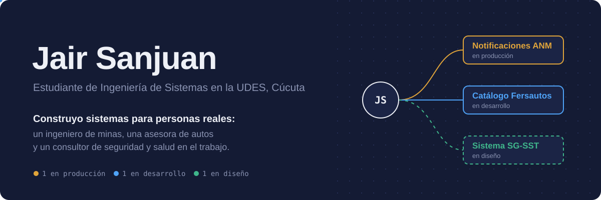
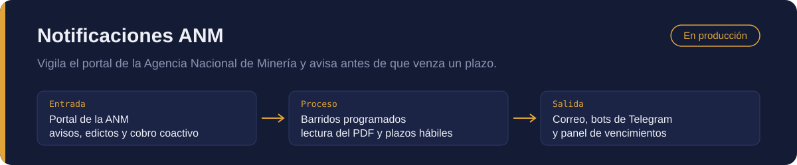
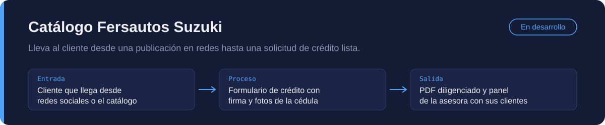
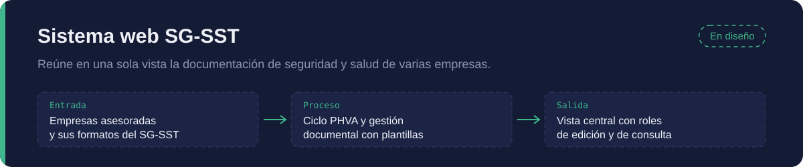
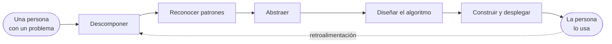

  
  
  

Me gusta el software que alguien abre todos los días para hacer su trabajo.
Cada proyecto de este perfil empezó con una persona y un problema concreto,
no con una tecnología. Abajo está cada uno descompuesto como lo pienso:
**qué entra, qué se procesa y qué sale**.

## Sistemas

`Python` `FastAPI` `PostgreSQL` `SQLAlchemy` `APScheduler` `PyMuPDF` `React` `Vite` `Telegram Bot API` `Railway`

Lo que resolví en este sistema

- Los plazos se calculan en **días hábiles con festivos de Colombia**, y "1 mes" como mes de corrido.
- Guarda copia de cada PDF por si la ANM lo retira del portal.
- Se vigila a sí mismo: alerta si un barrido falla o si el portal cambia su estructura.
- Dos bots de Telegram: uno para el usuario final y otro de administración.

`Next.js` `TypeScript` `Tailwind CSS` `PostgreSQL` `Drizzle ORM` `Better Auth` `pdf-lib` `Docker`

Lo que estoy resolviendo en este sistema

- Un enlace por red social registra de dónde llegó cada cliente y preselecciona el modelo.
- La firma y las fotos de la cédula se capturan desde el celular, dentro del formulario.
- El PDF sale diligenciado con el formato oficial del concesionario.
- Cuatro módulos: catálogo, formulario de crédito, panel de la asesora y panel de administración.

`Levantamiento de requerimientos` `Ciclo PHVA` `Multiempresa` `Stack por definir`

Decisiones de diseño hasta ahora

- Un consultor ve el archivo de todas las empresas que asesora desde una sola página.
- Los formatos se diligencian, se editan y se reutilizan al crear una empresa nueva.
- Dos perfiles: quien modifica y quien solo consulta.
- La app móvil de inspecciones y la firma digital quedan para la última fase.

## Cómo pienso un problema

La flecha punteada es la parte que más me importa: un sistema en producción
me enseña más que cualquier diagrama inicial.

## Herramientas

**Construyo con**

**Explorando para machine learning y deep learning**

## Lo que viene

- [ ] Un servidor propio (VPS) donde los tres sistemas corran de forma independiente
- [ ] Terminar el catálogo Fersautos en local y entregarlo
- [ ] Pasar el SG-SST de diseño a desarrollo
- [ ] Llevar machine learning a un problema real, como estos tres

## Actividad

<picture>
  <source media="(prefers-color-scheme: dark)" srcset="https://raw.githubusercontent.com/jairsanjuan21/jairsanjuan21/output/github-snake-dark.svg" />
  
</picture>

## Hablemos

  
  <!-- Cuando tengas tu usuario de LinkedIn, descomenta esta línea y reemplaza TU-USUARIO:
  
  -->

Primero entiendo el problema. Luego escribo el código.
